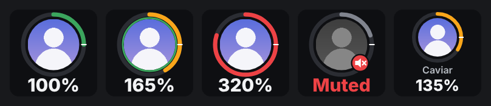
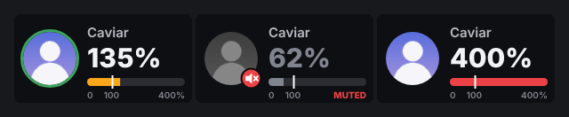
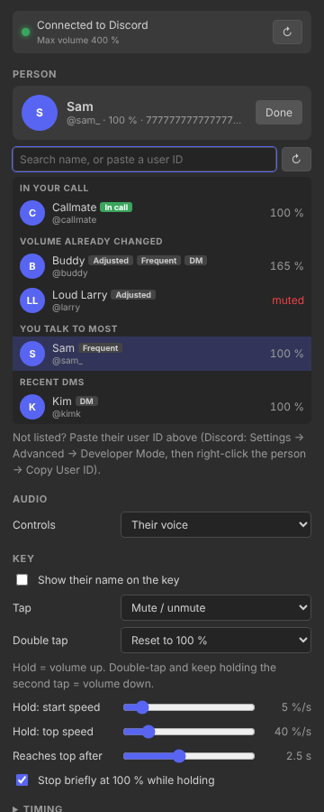
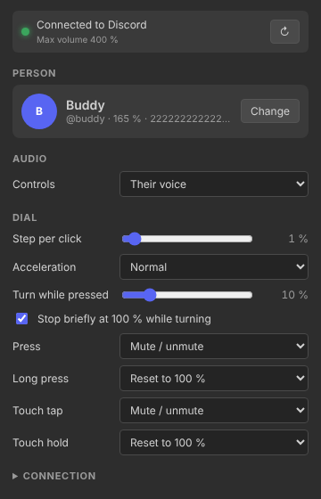

# Discord User Volume for Stream Deck

Turn one person's Discord volume up and down from your Elgato Stream Deck — a **key** with their avatar and live volume, or a **Stream Deck + dial** that works like a proper volume knob.






## Features

- 🧑 **One person per key / dial**: put your friends side by side and balance them in seconds
- 🖼️ **Avatar + live volume** on the key, updating instantly when the volume changes anywhere (even from Discord's own slider)
- ⬆️ **Hold to raise**: starts slow and gently speeds up
- ⬇️ **Double-tap and hold to lower**: same gentle ramp, downwards
- 🎛️ **Dial = real volume knob**: turn slowly for 1 % steps, spin fast for big jumps
- 🎯 **Sticky 100 %**: holding or turning pauses briefly at 100 %, so "back to normal" is easy to hit
- 🚀 **Up to your boost limit**: 200 % × Vencord VolumeBooster's multiplier (e.g. 400 %)
- 🔇 **Mute, reset and more** on tap, double-tap, dial press and touch: all configurable
- 👥 **Pick people easily**: suggestions from your call, your most-talked-to people, recent DMs and friends, or paste any user ID
- 📺 **Go Live audio** too: control someone's stream volume instead of their voice

## Requirements

- **Elgato Stream Deck** software **6.9** or newer (Windows 10+ / macOS 12+)
- Any Stream Deck for keys; a **Stream Deck +** for dials
- **Discord desktop app** with **[Vencord](https://vencord.dev/)** built from source
- The **[Vencord User Volume Deck](https://github.com/CaviarTheCatgirl/vencord-user-volume)** plugin installed and enabled

## Installation

### Option 1: Direct download (recommended)

1. Download the latest `com.darkside1305.user-volume.streamDeckPlugin` from [Releases](https://github.com/CaviarTheCatgir/streamdeck-user-volume/releases).
2. Double-click it. The Stream Deck software installs it.
3. **User Volume** appears under **Discord** in the actions list.

### Option 2: Manual

1. Download and extract the latest release.
2. Copy the `com.darkside1305.user-volume.sdPlugin` folder to:
   - **Windows**: `%APPDATA%\Elgato\StreamDeck\Plugins\`
   - **macOS**: `~/Library/Application Support/com.elgato.StreamDeck/Plugins/`
3. Restart the Stream Deck software.

## Setup

1. **Install the Vencord plugin first**: follow the [Vencord User Volume Deck guide](https://github.com/CaviarTheCatgir/vencord-user-volume), then restart Discord fully.
2. **Drag "User Volume"** onto a key, or onto a dial on a Stream Deck +.
3. **Pick a person** in the settings panel:
   - Tap someone from the suggestions, or
   - search by name, or
   - paste a **user ID** (Discord → Settings → Advanced → **Developer Mode**, then right-click the person → **Copy User ID**).
4. The status line at the top should say **Connected to Discord** and show your maximum volume.



## Usage

### On a key

| Gesture | Default |
|---|---|
| **Hold** | Volume **up**: starts at 5 %/s and smoothly speeds up to 40 %/s over 2.5 s |
| **Double-tap and keep holding** | Volume **down**, the same way |
| **Tap** | Mute / unmute them (for you only) |
| **Double tap** | Back to 100 % |

A hold that crosses 100 % stops there for half a second, then carries on gently.

> A single tap waits for the double-tap window (300 ms) before it acts. That's how it tells a tap from the start of a double tap.

### On a dial (Stream Deck +)

| Gesture | Default |
|---|---|
| **Turn** | Volume up / down. The faster you turn, the bigger each step |
| **Turn while pressed** | 10 % jumps |
| **Press** | Mute / unmute |
| **Long press** (0.6 s) | Back to 100 % |
| **Tap the touch strip** | Mute / unmute |
| **Hold the touch strip** | Back to 100 % |

Crossing 100 % while turning snaps there briefly. Keep turning past it a moment later.



## Settings

### Person & audio

| Setting | What it does |
|---|---|
| **Person** | Who this key / dial controls. Suggestions are grouped: *In your call*, *Volume already changed*, *You talk to most*, *Recent DMs*; search also finds your friends. |
| **Controls** | *Their voice*, or *Their Go Live stream audio*. |

### Key

| Setting | Default | Range |
|---|---|---|
| Show their name on the key | Off | |
| Tap | Mute / unmute | Mute / unmute · Reset to 100 % · Nothing |
| Double tap | Reset to 100 % | Mute / unmute · Reset to 100 % · Nothing |
| Hold: start speed | 5 %/s | 1 – 40 %/s |
| Hold: top speed | 40 %/s | 10 – 200 %/s |
| Reaches top after | 2.5 s | 0 – 6 s |
| Stop briefly at 100 % while holding | On | |
| Hold starts after | 300 ms | 150 – 800 ms |
| Double-tap window | 300 ms | 150 – 700 ms |

### Dial

| Setting | Default | Range |
|---|---|---|
| Step per click | 1 % | 0.5 – 10 % |
| Acceleration | Normal | Off · Low · Normal · High |
| Turn while pressed | 10 % | 1 – 50 % |
| Stop briefly at 100 % while turning | On | |
| Press / Long press | Mute / Reset to 100 % | Mute / unmute · Reset to 100 % · Nothing |
| Touch tap / Touch hold | Mute / Reset to 100 % | Mute / unmute · Reset to 100 % · Nothing |

**How acceleration works:** the plugin measures how many clicks per second you turned over the last 300 ms. Each click is multiplied by `1 + k · (clicks per second ÷ 10)^1.5`, capped at 10×. `k` is 0 / 0.5 / 1 / 2 for Off / Low / Normal / High. Slow turning stays at about your step size; a fast spin covers the whole range in under a second.

### Connection

| Setting | Default |
|---|---|
| **Port** | `37321`. Must match the Vencord plugin's *Port* setting |

## Troubleshooting

### Keys show "Discord off"
**Cause**: The plugin can't reach Discord.

**Solutions**:
1. Make sure Discord is running.
2. Check **UserVolumeDeck** is enabled in Discord → Settings → Vencord → Plugins.
3. After installing the Vencord plugin, restart Discord **fully** (quit from the tray).
4. Make sure the ports match on both sides. Press ↻ next to the status line to reconnect right away.

### Pressing a key shows a ⚠ alert
No person is picked yet, or Discord isn't reachable. Open the key's settings to see which.

### Keys show "Pick a person"
Open the key's settings and choose someone.

### No suggestions in the list
Suggestions load once Discord is connected. You can always paste a user ID; search also covers your friends.

### The maximum is only 200 %
Enable **VolumeBooster** in Vencord and raise its multiplier. The new maximum shows up immediately.

### Tapping feels slow
A single tap waits for the double-tap window. Lower **Double-tap window**, or set **Double tap** to *Nothing* and use a shorter window.

## Development

### Prerequisites
- Node.js 20+ and npm
- [Elgato Stream Deck CLI](https://docs.elgato.com/streamdeck/cli/intro) for packing (`npm i -g @elgato/cli`)

### Setup

```bash
git clone https://github.com/CaviarTheCatgir/streamdeck-user-volume.git
cd streamdeck-user-volume

npm ci
npm run build     # bundles src/ → com.darkside1305.user-volume.sdPlugin/bin/plugin.js
npm run watch     # rebuild on change + restart the plugin in Stream Deck
```

Link the plugin into Stream Deck while developing:

```bash
streamdeck link com.darkside1305.user-volume.sdPlugin
```

### Building a release

```bash
npm run build
streamdeck pack com.darkside1305.user-volume.sdPlugin
```

### Project structure

```
streamdeck-user-volume/
├── src/
│   ├── plugin.ts                # entry: registers the action, connects
│   ├── bridge.ts                # connection to Discord: SSE stream + JSON calls, auto-reconnect
│   ├── fallback.ts              # images for "Pick a person" / "Discord off" / "Loading…"
│   └── actions/
│       └── user-volume.ts       # key gestures, ramps, dial acceleration, 100 % detent
├── com.darkside1305.user-volume.sdPlugin/
│   ├── manifest.json
│   ├── layouts/user-volume.json # touch strip: one 200×100 image
│   ├── ui/user-volume.html      # settings panel (person picker + options)
│   └── imgs/
├── docs/                        # README images
├── rollup.config.mjs
└── package.json
```

## Technical details

### Communication

- **Transport**: HTTP on `127.0.0.1:37321`. Browsers are refused by the Discord side ([details](https://github.com/CaviarTheCatgir/vencord-user-volume#security)).
- **Live updates**: one **Server-Sent-Events** stream. Discord pushes a finished image for every visible key / dial whenever something changes (volume, mute, speaking, avatar), so nothing is polled.
- **Images are drawn in Discord** (canvas) and only displayed here; the touch strip is a single 200 × 100 pixmap.
- **Commands**: small JSON calls: `/adjust` (relative, used by holds and dials), `/set`, `/mute`, `/suggestions`, `/user`.
- Full API: [Vencord plugin README](https://github.com/CaviarTheCatgir/vencord-user-volume#api-reference).

### Smoothness

- Holds tick every 30 ms; the speed follows a smoothstep curve from start to top speed.
- Only **one** request per key is in flight. Steps that happen meanwhile are added up and sent together, so a fast dial spin never queues up a backlog.
- Images are drawn at most every 40 ms per key, always the newest.
- If Discord goes away, the plugin reconnects with back-off (0.5 s → 5 s) and re-registers every key. After a Discord reload (Ctrl+R), keys are re-registered automatically.

## License

MIT

## Credits

**Created by**: DarkSide1305

**Related projects**:
- [Vencord User Volume Deck](https://github.com/CaviarTheCatgir/vencord-user-volume): required Discord plugin
- [Stream Deck Krisp Toggle](https://github.com/CaviarTheCatgir/streamdeck-krisp-toggle): Krisp on a key

**Built with**:
- [Elgato Stream Deck SDK](https://docs.elgato.com/streamdeck/sdk/introduction/getting-started) (`@elgato/streamdeck` v2)
- TypeScript, Node.js 20, Rollup

## Support

- 🐛 **Bug reports**: [Open an issue](https://github.com/CaviarTheCatgir/streamdeck-user-volume/issues)
- 💡 **Feature requests**: [Open an issue](https://github.com/CaviarTheCatgir/streamdeck-user-volume/issues)

## Changelog

### v1.0.0 (initial release)
- ✨ User Volume action for keys and Stream Deck + dials
- ⬆️⬇️ Hold to raise, double-tap-and-hold to lower, with gentle acceleration
- 🎛️ Speed-sensitive dial with coarse mode while pressed
- 🎯 Pause at 100 % for holds and dials
- 👥 Person picker with suggestions and user-ID lookup
- 📺 Voice or Go Live stream audio
- 🔁 Automatic reconnect and re-registration
